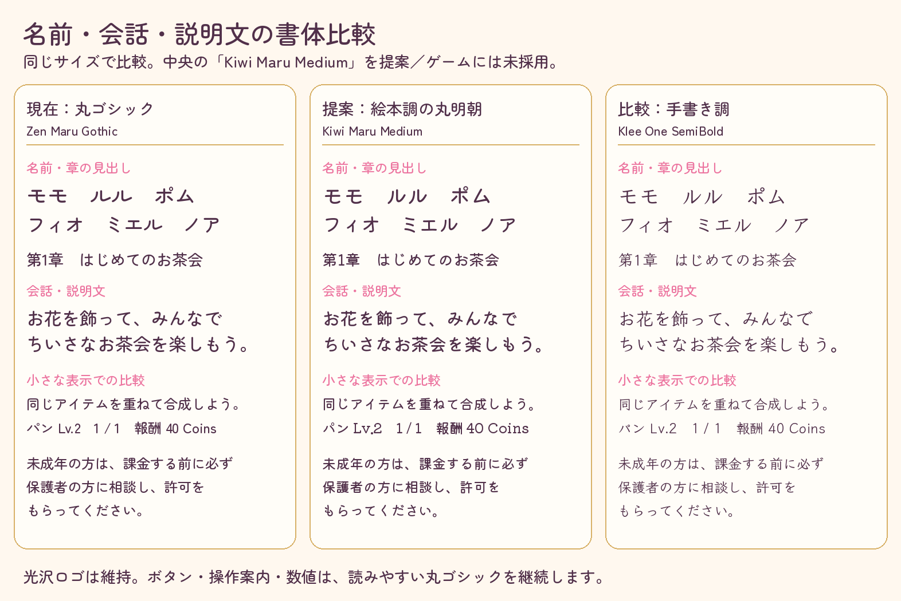

# 章構成・メルヘン調書体の確認用見本

2026-10-11（日本時間）。[章ごとのゲーム設計](../../../docs/superpowers/specs/2026-10-11-chapter-game-design.md)のための比較資料です。**ゲームにはまだ採用していません。Unity／Pixelのスクリーンショットではありません。** 正式キャラ・背景・ロゴの画像は変更していません。

文字サイズと内容をそろえ、実際のフォントで描画しました。中央の**Kiwi Maru Medium**を名前・紹介・会話・物語説明に提案。丸い明朝の字形が絵本らしく、細い手書き調より小さい表示で線を保てます。ボタン・操作説明・数値・課金案内は既存Zen Maru Gothicを維持する案です。タイトルは承認済みの光沢ロゴ画像を維持します。

見本の数値40 Coinsは書体比較用で、ゲーム進捗の記録ではありません。見本の課金案内は正式文言を使っています。ゲームでの改行・字形・可読性はWindowsのFontEngineとPixelで別に確認します。

## 出典

| 書体 | 配布元・ライセンス | 元TTF SHA256 |
| --- | --- | --- |
| Zen Maru Gothic Medium（現行） | [Google Fonts](https://github.com/google/fonts/tree/main/ofl/zenmarugothic)、SIL OFL 1.1 | `3cfdb98a13571ede17fcc769f5093a97c38b80a7b9b2ab754a26b4d822092b3b` |
| Kiwi Maru Medium（提案） | [Google Fonts](https://github.com/google/fonts/tree/main/ofl/kiwimaru)、[作者](https://github.com/Kiwi-KawagotoKajiru/Kiwi-Maru)、SIL OFL 1.1 | `b2659f300a7d48c3f29eb273ffc5e1b26cc416ac8c37ff6bb2f3e43c2f4d235a` |
| Klee One SemiBold（比較） | [Google Fonts](https://github.com/google/fonts/tree/main/ofl/kleeone)、[作者](https://github.com/fontworks-fonts/Klee)、SIL OFL 1.1 | `b031ec426c23ca1143ef1f7d58bee7a79efe119ed654152f121c922202b303fd` |

Kiwi Maruの配布METADATAのsource commitは`65a112c7ec9ffe81595406982a670c7f945d7c5b`、Klee Oneは`8b0532731b63ad8a445ca341d8d7d941079b83ab`。取得したMETADATAとOFLを確認し、上記の取得実体のSHAを記録しました。見本に使った全表示文字のcmap収録を確認し、3書体とも欠落0です。

Kiwi Maru Mediumには現行Resourcesの2書体の全439文字も収録され、cmap欠落0です。これはフォントファイルの収録確認で、Unityのインポート・FontEngine・画面の文字切れの合格判定ではありません。

元TTFは候補比較用にクラウドの作業用領域へ取得し、Resourcesや製品の依存関係へは追加していません。採用時に必要字形のサブセットとOFL／著作権表記を同梱し、実描画を検証します。比較PNGは1572×1050、Pillow／FreeTypeによる標準描画で作成した資料です。
