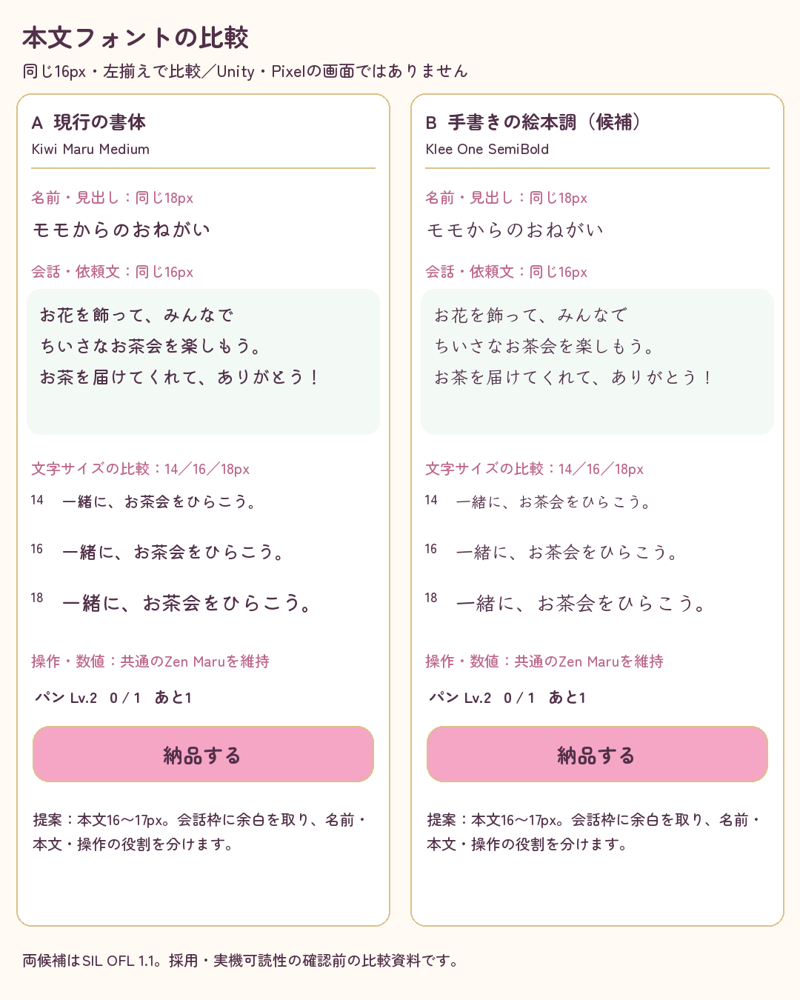
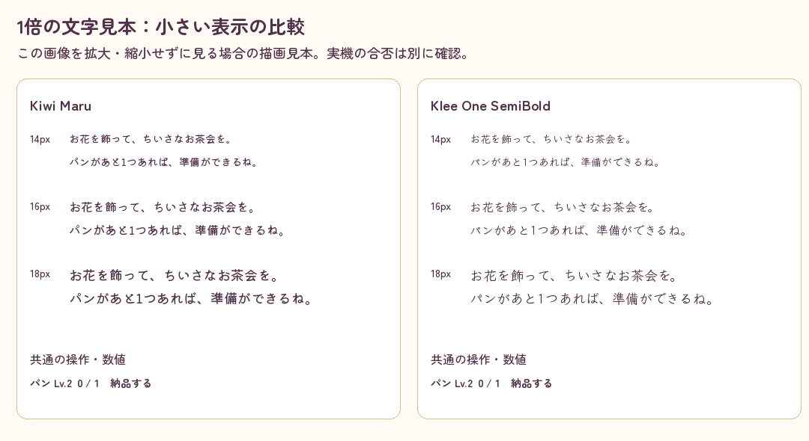
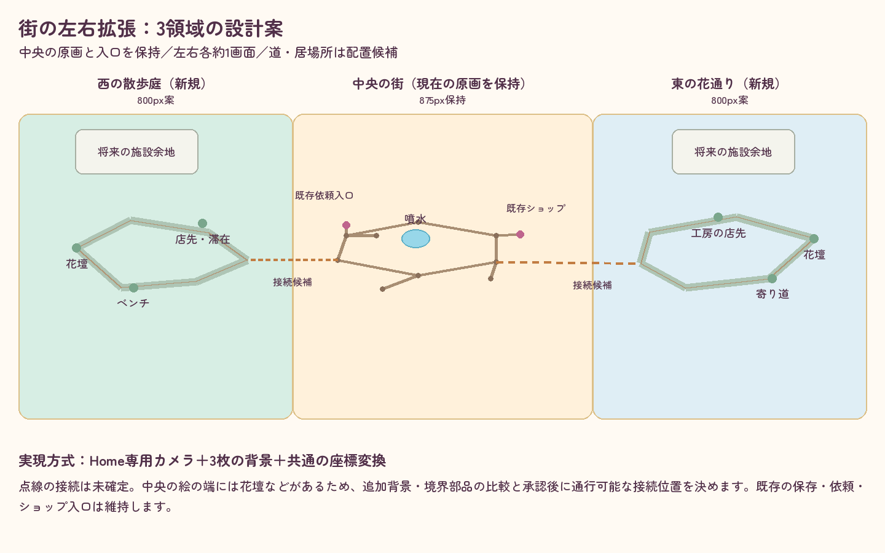
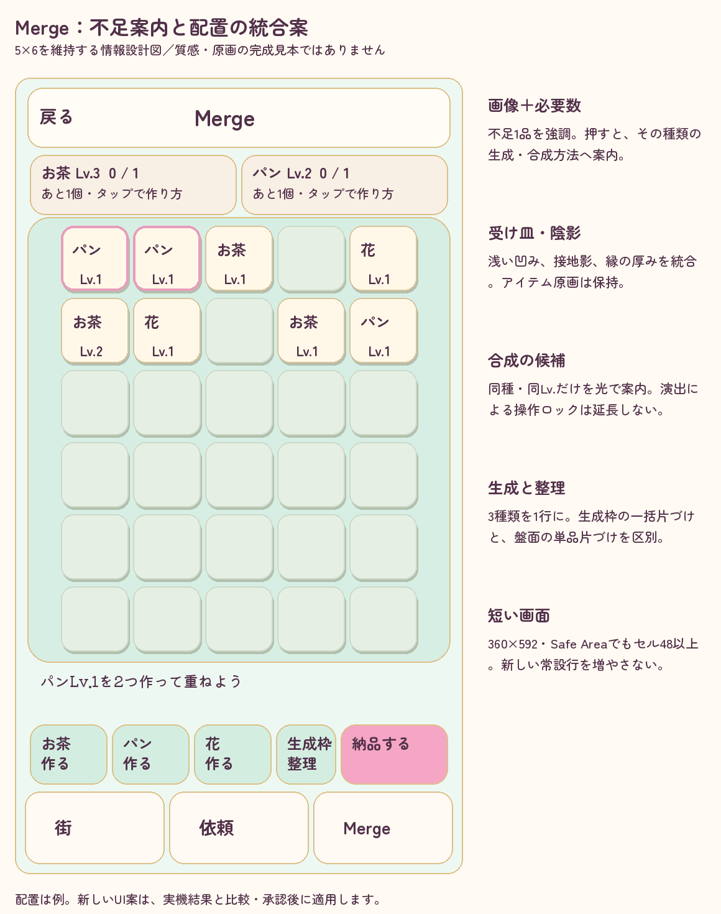

# 10月14日：書体比較と街／Merge配置案

[確認用設計](../../../docs/superpowers/specs/2026-10-14-storybook-and-town-expansion-review.md)に対応する資料。**製品へ未適用で、Unity／Pixelのスクリーンショットではありません。正式原画は変更していません。**

## 本文書体

現行Kiwi Maru Mediumと、新候補Klee One SemiBoldを同じ設計サイズ16・左揃えで比較。見出し18、14／16／18の文章、共通のZen Maru操作／数値も表示しています。メイン図は文字比較を見やすくするため1.5倍の描画。設計サイズはゲームのCanvas単位に対応させる候補で、Pixelの物理画素を再現したものではありません。

こちらは1倍の14／16／18見本。Pillow／FreeTypeで実フォントから描画し、UnityのFontEngine・Textの収まり・実機の可読性は別に確認します。Bの初回試験範囲は会話と依頼本文で、名前・見出しを一括変更する提案ではありません。ボタン・数値はZen Maruを維持します。

| 書体 | 取得記録・ライセンス | 元TTF SHA256 |
|---|---|---|
| Kiwi Maru Medium | [既存の取得記録](../chapter-game-review-2026-10-11/README.md)、SIL OFL1.1 | `b2659f300a7d48c3f29eb273ffc5e1b26cc416ac8c37ff6bb2f3e43c2f4d235a` |
| Klee One SemiBold | [Google Fonts](https://github.com/google/fonts/tree/main/ofl/kleeone)、[Fontworks](https://github.com/fontworks-fonts/Klee)、[OFL](KleeOne-OFL.txt) | `b031ec426c23ca1143ef1f7d58bee7a79efe119ed654152f121c922202b303fd` |
| 共通のZen Maru | [既存出典](../../../docs/ui-pop-assets.md)、SIL OFL1.1 | Medium `3cfdb98a13571ede17fcc769f5093a97c38b80a7b9b2ab754a26b4d822092b3b`、Bold `fe24426b9c8b5523a0146a8235c8674eccf0493af354a53ec895c3596d9eb745` |

旧記録と実体SHAを照合。Kiwi／Kleeとも現在のUIFontStoryの484マッピングを収録。見本の全表示文字の欠落0。[検査と画像SHA記録](review-evidence.json)。元TTFは比較用のクラウド領域に置き、Resourcesへ追加していません。

## 街の左右拡張

中央875×1798を保持し、左右800×1798を追加する候補。基準Pixel画面・倍率で左右各約1画面になる設計です。図の線は通行図の候補で、点線の中央接続は未確定。花壇や建物を通り抜ける経路を承認済みとは扱いません。

## Mergeの情報設計

画像＋必要数、次に作る品の案内、受け皿・接地影、生成・整理・納品の順を整理。**アイテムの文字ラベルは配置を示す代用で、正式画像を文字へ置換しません。質感の完成見本ではありません。** 図の配置と個数は例で、実進行のスクリーンショットではありません。
