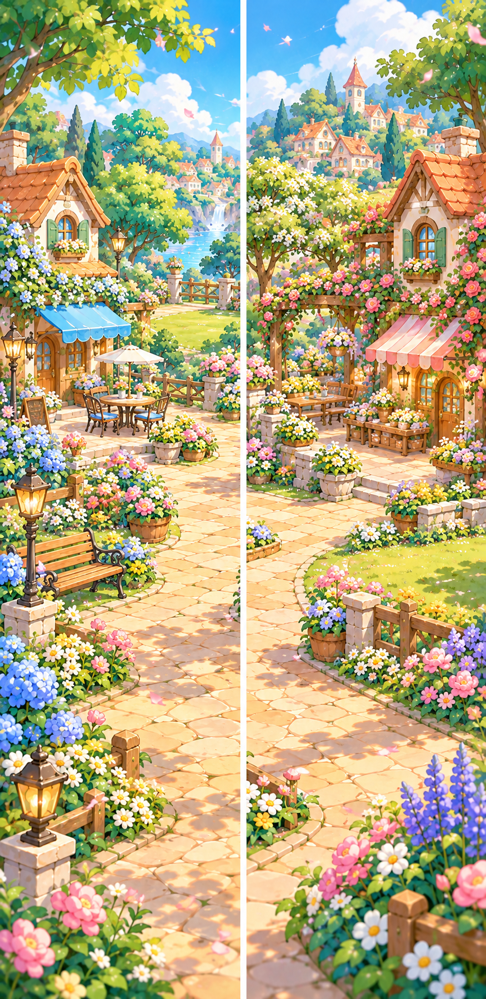

# 10月14日：左右の追加領域の雰囲気比較

[本文候補と次段階の報告](../../../docs/development-handoff-2026-10-14-body-trial.md)。imagegenで制作した確認用の絵。製品へ未適用。

左は木陰のベンチ・カフェ前、右は花の小道・工房前。中央街のTownBackgroundを様式参考にし、中央自体はこの絵へ再制作していない。元の正式PNGは変更していない。

この875×1798のシートは左右の雰囲気をまとめた比較用で、左右各800×1798の製品素材ではない。接ぎ目・経路・施設の配置は未確定。採用前に左右を個別に制作し、中央の障害物を避ける通路とカメラを確認する。[3領域の配置とカメラの設計](../../../docs/superpowers/specs/2026-10-14-storybook-and-town-expansion-review.md#4-街の左右各約1画面拡張)。

生成元 `/workspace/generated_images/exec-877d59b2-f3d8-4dc9-a37a-18d2dfa66b3b.png` を保持し、同一ファイルをここへコピー。SHA256 `96e4d1ec2768dadeede50f61730cb01b077d0d912a6353945c674ecc0cc6c2a3`。
