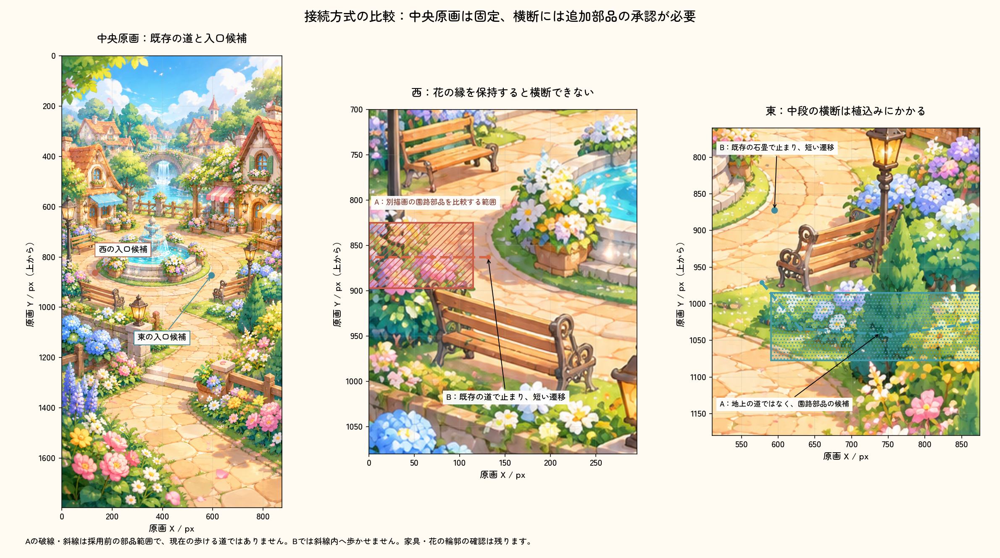
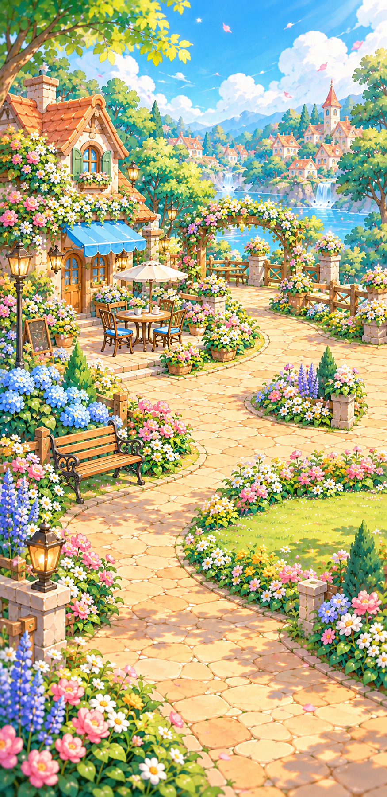
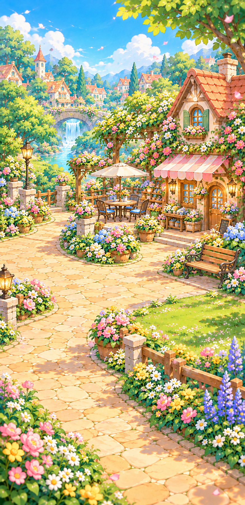
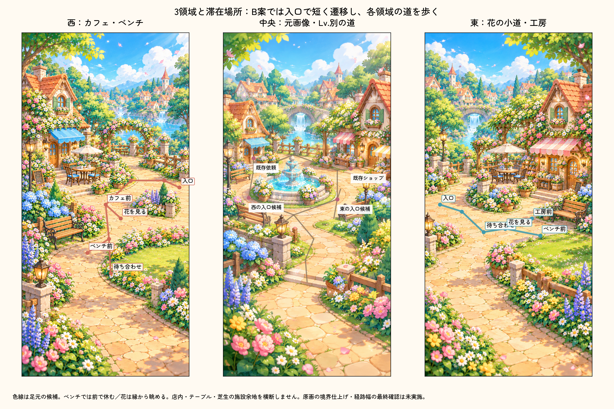
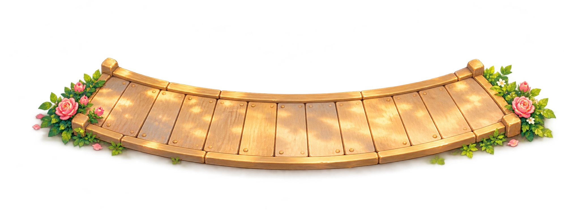

# 左右の街：接続図・個別素材・キャラ導線

**確認用・ゲームへ未適用。** [設計と方式の比較](../../../docs/superpowers/specs/2026-10-14-town-side-connections-design.md)。西＝カフェ・ベンチ、東＝花の小道・工房の具体化。9月22日の世界観と中央の正式PNGを維持する。

## 中央との接続

Aの破線・斜線は別素材の園路が必要な範囲で、今の地上の道ではない。Bは既存の石畳上の入口で止まり、短い遷移で隣へ入る案。図には元の中央画像を読取り表示し、座標と注意範囲だけを設計図として重ねた。原画ファイルは編集していない。

## 西側素材案

875×1798。広い道のほか、カフェ前・ベンチ前・花を見る縁を確保する候補。写真や完成ゲームのスクリーンショットではない。座り動作や店内購入は未実装。

## 東側素材案

875×1798。花壇の外側に道、工房前とベンチ前へ枝を設ける候補。左右を中央とそのまま横に並べて無継ぎ目になったと扱わない。Aでは新背景の境界仕上げと入口部品の比較が必要。

## キャラの移動・滞在

中央は既存カタログのLv.別の枝を含む図。実際の解放は保存済みLv.に従う。西／東の色線はBの各領域内の候補で、花壇・椅子・テーブル・将来の施設用の芝生へ足元を入れない。足元幅・家具の輪郭・HUD・人物の重なりは採用前に確認する。[座標JSON](route-proposals.json)は資料であり、Coreへ導入していない。

## Aに必要な別素材の材質案

RGBAの透過画像。中央へ重ねた完成見本ではない。実際に置くと中央の花の一部を見た目上覆うため、その差も承認が必要。正式PNG保持を「画面の全ての見え方が同じ」と言い換えない。

左右素材と部品はimagegenで制作。生成元は`/workspace/generated_images/`に保持し、同一PNGをこのPreviewへコピーした。正式キャラ・街・ロゴを変更していない。[寸法・SHA・原画保持の記録](review-evidence.json)。
