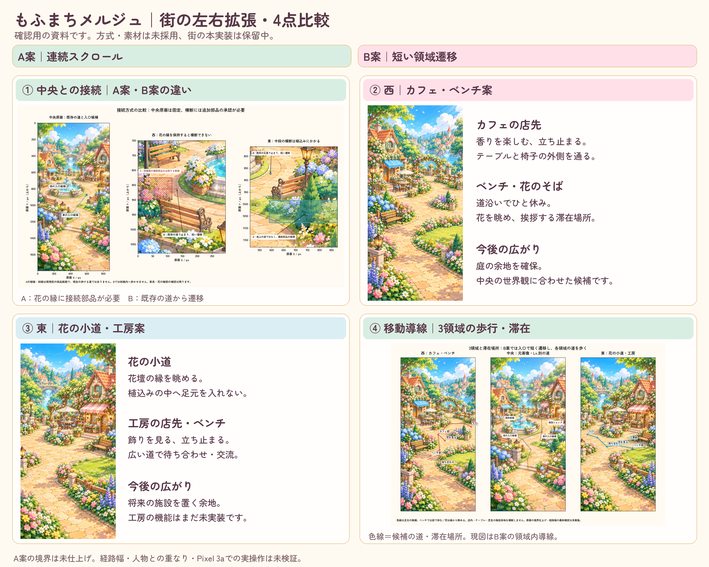
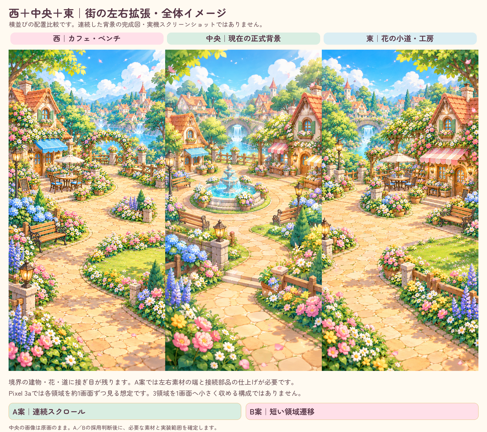
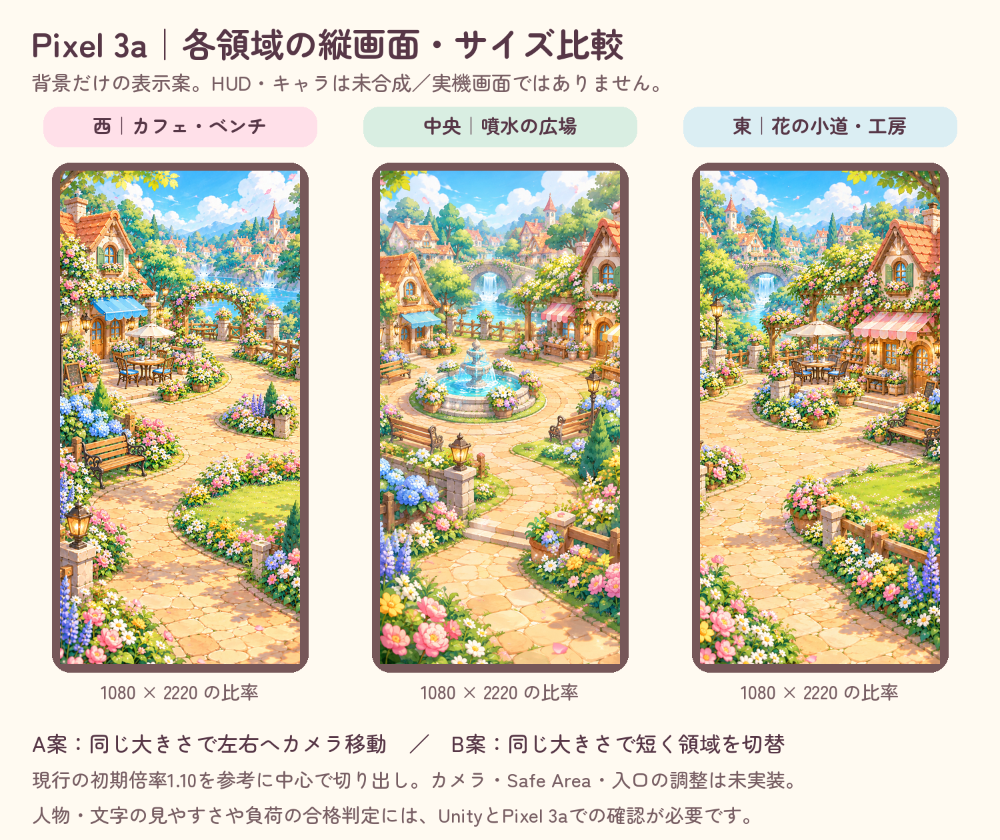

# 街の左右拡張：会話内の再提示用資料

**最新決定：画像確認済み、B案を先行採用。A案は将来候補として保持。** [B案の具体的な7工程の実装計画](../../../docs/superpowers/plans/2026-10-14-town-regions-b.md)はレビュー待ちで、ゲームへ未適用。

以下のPNG・PDFは選択前の比較資料をそのまま保持する。画像内の「未採用・保留」は制作時点の表記。B採用後も、足元幅・家具との重なり・Unity／Pixelでの動作は未検証。

ユーザーが個別のGitHubリンクから4画像を確認できなかったため、既存の確認用素材を見出し付きでまとめた。街・キャラクター・ロゴ・ゲームコード・保存・納品・報酬は今回変更していない。

## 画像とPDF

- [4点比較PNG](town-four-point-comparison.png)：①中央との接続、②西のカフェ・ベンチ、③東の花の小道・工房、④3領域の移動・滞在導線。
- [西＋中央＋東の横並びPNG](town-overall-west-central-east.png)：原画を同じ大きさで並べた配置比較。中央部分は元PNGと画素単位で一致する。
- [Pixel 3aの背景表示サイズ比較PNG](pixel3a-region-framing-comparison.png)：1080×2220の比率と現行の初期倍率1.10を参考にした切り出し。HUD・キャラ未合成、実機スクリーンショットではない。
- [まとめPDF・7ページ](town-expansion-review.pdf)：4点比較、中央接続の詳細、西の詳細、東の詳細、導線の詳細、横並び全体図、Pixel比率の表示比較。

## 判断する違い

| 方式 | 見せ方 | 採用前に残る作業 |
|---|---|---|
| A＝連続スクロール | 同じ大きさでカメラが左右へ移動し、境界も歩く | 左右素材の境界・通行幅・追加園路の見た目を仕上げる。中央の花の一部を別部品が覆う可能性は別途確認 |
| B＝短い領域遷移 | 既存の道の入口で短く切り替え、隣の街を歩く | 入口での遷移・人物の復帰・入力とカメラの調整。移動図はこの方式の領域内候補 |

横並び図には建物・花・道の接ぎ目が残っている。連続背景の完成図と扱わない。各領域を約1画面ずつ見る想定で、3領域全体をPixelの1画面へ縮小する提案ではない。

今回の作業は画像の配置・見出し・PDF化のみ。[元の4画像と接続案](../town-connection-review-2026-10-14/README.md)の素材・設計・原画は変更していない。[検証記録](presentation-evidence.json)には元画像のSHA256、中央の一致範囲、表示比較の切り出し範囲、生成ファイルの寸法・PDFページ数を記載する。

Unity・Pixel 3aでの新しい街の操作、経路幅、継ぎ目の完成、HUDとの重なり、負荷は未検証。本実装は画像と方式の確認後に、検証状況・変更対象・実装計画を確認してから進める。
