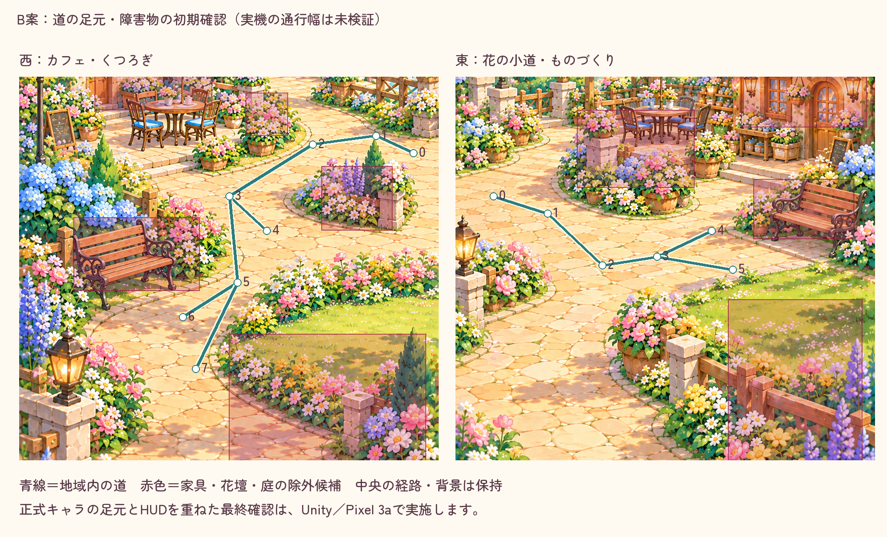

# B案の地域内の道と足元

元絵を変更せず、地域内の線と独立した除外候補を重ねた設計／初期確認図。青線は現在のカタログ、赤はテスト側で読取り調査した家具・花壇・庭。ピクセルの描き替えではない。

西の待合と上の曲がり、東の工房前とベンチ前を道側へ微調整した。中央の原画・地図・旧施設入口と、領域間の入口座標は不変。位置は左下原点の0〜1で、将来の全体座標と区別する。[数値と元PNGのSHA](survey.json)。

7件のCore経路検査は成功。独立した矩形は絵全体の完全な障害物マスクではない。正式キャラの足元幅・札・HUD・通路の見た目はUnityとPixelで未検証。
