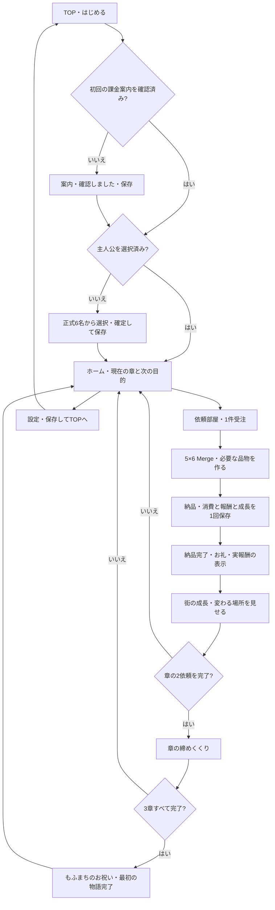

# 章ごとの依頼と街の成長 — 最初の物語を遊び切る設計

2026-10-11（日本時間）。**ユーザーの「設計を承認して実装計画へ進める」を受領した承認済み設計です。章機能・新書体・動きの修正はまだ実装していません。** [7工程の実装計画](../plans/2026-10-11-chapter-game.md)へ具体化しました。前回の[街の生活の設計](2026-10-11-town-life-design.md)と実装を土台にします。[12項目の引き継ぎ](../../development-handoff-2026-10-11.md)に現状と実機確認の範囲を記載しています。

## 1. 合意した目的と今回の範囲

ユーザーの回答は「章ごとの依頼・街成長で、最初から一区切りまで遊べる構成」。仲間と暮らし、品物を合成して届ける成果が街に残り、最初の物語を最後まで遊べることを目指します。2026年10月末の公開目標を維持し、Pixel 3aでの一周・セーブ復帰・見た目と操作の品質を優先します。

追加方針は「設計の見直しもあり得る」「販売日程はあくまで目標」「誰も真似できないコンセプトを目指す」。第1章の実機試遊で楽しさ・親しみ・操作感・街の成果の伝わり方を評価し、必要な設計を見直します。独自性の軸は6名の性格と会話、仲間へのお届け、成果が景色に残る暮らしのつながりです。新機能の数を独自性の代わりにせず、競合に同じ要素が存在しないと保証する扱いにはしません。

今回の提案は**既存6依頼を3章にまとめる最初の物語**です。全体の流れ、各画面の役割、章の終わり、再開時の挙動を完成させます。長期運営用の大量ステージや自由建築まで完成したとは扱いません。6依頼で一般公開に十分な遊びの長さがあるかは、実機で遊び切ってから判断します。

本日のFBを反映します。

- 承認された街・ロゴ・正式6名・花と金縁・明るいPOPの方向は維持。
- 名前、紹介、会話、物語説明にメルヘン調の書体。操作や数値は読みやすく。
- 指で動かす主人公と5名の往来を滑らかにし、停止中の不自然な上下動を解消。
- 各画面で「今の目的」「必要な品物」「次に進む先」が分かり、最後に明確な達成感を出す。

主人公はモモ・ルル・ポム・フィオ・ミエル・ノアの1名。正式ID、顔、配色、衣装、シルエット、採用済み全身と通常／笑顔／驚きの3表情を固定します。後ろ姿・独立した脚の歩行コマ・新衣装を無断で追加しません。

## 2. 構成の選択肢と採る方式

| 方式 | 遊び方と工程 |
| --- | --- |
| **既存6依頼を3章に接続（提案）** | 6名全員と関わり、Lv.6の街で最初のお祝いまで到達。既存の品物・保存・報酬を使い、説明・章の締め・街の見た目を完成させる |
| 新しい多数の依頼を含む長編 | 長く遊べるが、追加素材・数量バランス・台詞・保存移行・全依頼の実機検証が増える。最初の物語の安定後に評価 |
| 自由建築を中心にする | 街の配置や購入を楽しめるが、施設配置・経済・建築保存など別の基盤が必要。今回は着手しない |

現在の6依頼を使う方式を提案します。街の成長は固定位置への装飾追加で表現し、ショップは引き続き外観と準備中の案内だけに限定します。販売、課金、広告、イベント、図鑑、新通貨、スタミナ制限を増やしません。

## 3. 起動から一区切りまで

初回案内の正式文案と「確認しました」は変更しません。保存済みのユーザーに毎回選択や序章を強制しません。序章はホームの目的カードに「仲間とお茶会をひらこう」と短く表示し、新しい必須モーダルや保存フラグを増やしません。

各画面は縦全体を使う既存Canvas／Safe Areaの仕組みを継続します。主人公を依頼部屋前へ動かして指を離す→入室ボタン、または下ナビ「依頼」で同じ依頼画面へ進みます。施設前を通過しただけで画面を切り替えません。

## 4. 3章と6依頼

以下の章名・短い物語文を提案します。依頼の固定ID、順序、要求数量、Coinsは現実装から変更しません。主人公と依頼者は独立し、自分と同じキャラからの依頼も成立します。

| 章 | テーマと次の目的 | 依頼者・固定ID | 必要品 | 各報酬 |
| --- | --- | --- | --- | --- |
| 1 はじめてのお茶会 | 「お茶とパンをそろえて、仲間を迎えよう」 | ルル `tea-01` | お茶 Lv.2 ×1 | 30 Coins |
| 1 はじめてのお茶会 | 同上 | モモ `bread-01` | パン Lv.2 ×1 | 40 Coins |
| 2 花の香る広場 | 「花を飾って、ひと休みできる広場へ」 | ミエル `flower-01` | 花 Lv.2 ×1 | 40 Coins |
| 2 花の香る広場 | 同上 | ポム `tea-02` | お茶 Lv.3 ×1、パン Lv.2 ×1 | 70 Coins |
| 3 もふまちのお祝い | 「彩った広場で、みんなのお祝いをしよう」 | フィオ `flower-02` | 花 Lv.3 ×1、お茶 Lv.2 ×1 | 70 Coins |
| 3 もふまちのお祝い | 同上 | ノア `bread-02` | パン Lv.3 ×1、花 Lv.2 ×1 | 80 Coins |

新規データから全6件を各1回完了すると、累計330 Coins／街Lv.6。章1終了時は70／Lv.2、章2は180／Lv.4です。これは確認用の基準値で、画面は保存済みの実Coins・実街Lv.を表示します。引き継いだデータをこの基準値で上書きしません。

合成は3系統×Lv.1〜3を維持。異なる系統は合成不可、1回の生成は選択系統のLv.1を1個、同時受注1件、最大Lv.3。初回のLv.1お茶2個で操作を案内します。パン・花の生成はすでに利用できるため、章の追加により既存品をロックしたり盤面から消したりしません。最初の該当依頼でその系統を案内するだけにします。

## 5. 画面ごとの役割と章の締め

| 画面 | 今回追加・調整する体験 | 守ること |
| --- | --- | --- |
| TOP | 現行の光沢ロゴと6名の構成を維持 | 「はじめる」から保存済み進行へ戻れる |
| 主人公選択 | 名前と紹介を絵本調に。選択反応の開始／終了を滑らかに | プレビューでは保存しない、確定時だけ保存 |
| ホーム | 現在の章／章内の完了数と次の依頼を目的カードに表示 | 新パネルを街いっぱいに重ねず、道・入口・水を見せる |
| キャラ依頼 | 章名、実依頼者の名前・台詞、所持／必要数、実報酬、受注ボタン | 次の未完了依頼を表示。未完了の受注を勝手に差し替えない |
| Merge | 依頼の進捗と必要な系統を案内 | 5×6の正方形セル、指操作、9種、確認付き単品片づけを維持 |
| 納品／報酬 | 依頼者のお礼と実際に納品した品物・報酬を見せる | 支払いは保存成功時の1回だけ、演出や再表示で増やさない |
| 街成長 | 変更場所を短く強調し、その装飾を街に残す | 元背景、通行範囲、施設位置は維持 |
| 章の締め | 2件完了を祝い、次章の目的を短く示す | 独立した章ボーナスや追加支払いを作らない |
| 最初の物語完了 | 全6名の笑顔、完成した街、実進行のまとめ | 未実装の「続き」を押させない、再受注や保存初期化をしない |
| 設定 | 音、主人公再選択、戻る、保存してTOPへ | 各画面へ正しく戻る。保存失敗ならTOPへ進まない |

章末は2件目の納品後の成長画面から、明示ボタンで締めへ進みます。章1・2の締めは「次の章へ」でホームへ戻り、次の依頼を案内します。3章目は同じ導線で最初の物語完了画面へ進みます。操作を奪う長い自動演出は避け、演出後を待たずに進めるボタンを用意します。

完了画面の文案は「みんなのお茶会がひらけました！」「仲間へのお届けで、もふまちが華やかになりました。」。完了数6/6と保存済みCoins／街Lv.を表示し、「街へ戻る」「保存してTOPへ」を設けます。完了後の街は散歩・会話・設定・盤面の合成を継続でき、依頼カードは「最初の物語をふりかえる」に変わります。新しい依頼や報酬があるようには表示しません。

章の締めと完了画面は表示機能です。起動後に自動で再払い・再演出せず、保存済み進捗からホームへ復帰。章末直後に終了しても、ホームの目的カードから最後に完了した章のまとめを開けます。まとめの再表示で支払いません。設定を開いて戻る際は、元の章末／完了画面を維持します。Androidの戻るでホームへ、ホームから保存してTOPへ戻る既存方針を継続します。

## 6. 街が華やかになる段階

既存のLv.1〜3装飾を保持し、Lv.4〜6に景色の変化を追加する提案です。現実装は小さな花・星の重ね表示のみで、下表の完成外観がすべて存在するわけではありません。

| 街Lv. | 景色に残す変化 | 実装との関係 |
| --- | --- | --- |
| 0 | 現在の美しい街と噴水を基準にする | 共通背景を維持 |
| 1 | 小さな花の装飾 | 既存の表示を維持 |
| 2／章1終了 | 広場の花飾りが増える | 既存の表示を維持、章末で成果を案内 |
| 3 | 噴水周りの星の光 | 既存の表示を維持、常時大量発光にしない |
| 4／章2終了 | 広場の縁と店先に歓迎リボン | 新規の小さな固定装飾。ショップ販売は追加しない |
| 5 | 入口脇に花のアーチ | 新規の固定装飾。通行場所と入口ボタンを隠さない |
| 6／章3終了 | ガーランドと広場を囲むお祝いの彩り | 新規装飾。短いお祝い演出後も景色に残す |

背景の明るさと色は保ち、装飾を全画面に散らすのではなく、広場と施設前の決めた位置へ重ねます。花や金縁のタッチを既存UIと統一。成長時に増えた場所だけ1秒程度強調し、花びら・きらめきは少量に限定します。位置は街背景のUVにひも付け、解像度が変わっても同じ場所に残します。

外観は保存済み`townGrowthLevel`から再構築し、新しい建築保存データを増やしません。Lv.6以上はLv.6外観を維持して値を変更しません。演出の途中で中断しても、復帰時に最終装飾は表示されます。

## 7. 名前・説明文の書体

[実フォントの比較見本](../../../References/Preview/chapter-game-review-2026-10-11/font-comparison.png)の中央、**Kiwi Maru Medium**を名前・紹介・会話・章名・物語説明に提案します。丸みのある明朝で、絵本らしい雰囲気と線の太さを両立します。比較したKlee One SemiBoldは手書きの雰囲気が強い一方、小さい街の名前で線が細く見えるため第一候補にはしません。

- タイトルロゴ：現行の光沢ロゴ画像を維持。
- 物語・キャラの文字：Kiwi Maru Mediumで統一。街の名前は現在11から最低12 Canvas単位へ。会話・説明は14を基準、章名・見出しは18〜22。
- ボタン・操作説明・音設定・数値・初回課金案内：既存Zen Maru Gothic Medium／Bold。押す場所、数量、注意文は明確に読めるようにする。
- 文字色は現在の濃いプラムを基準に、クリームや淡い色の不透明パネルへ表示。細字へ強い金色の影を重ねない。
- 長文は適切に改行して枠を広げ、縮小して押し込まない。行間は約1.2、操作要素を避けた余白を確保。課金案内は文言を変えず「保護者」などの語を不自然に分断しない。

Google Fonts配布の実TTFとSIL OFL 1.1を確認しました。[出典・SHA・見本の記録](../../../References/Preview/chapter-game-review-2026-10-11/README.md)に記載。採用時は表示文字を抽出してサブセット化し、ライセンスと著作権表記を同梱します。元TTF全体をそのまま追加してAPKを大きくしません。新旧フォントの必要字形とUnity FontEngineの実描画を検査し、Pixelで小さな名前が読めることを合格条件にします。見本PNGはUnity描画の証拠ではありません。

## 8. キャラと環境の動き

### 確認できた問題と限界

静止PDFは動きの滑らかさを証明できません。ユーザーの「ぎこちない」という報告に加え、コードで次を確認しました。

- `TownLifeView.Update`は「現在時刻＋1/30秒」まで更新を飛ばし、毎回固定の1/30だけ移動。実フレーム間隔が揺れると更新を取りこぼし、実時間と移動がずれやすい。
- `TownActor`の上下動は移動距離ではなく指の所有・待機タイマーで決まる。指を押して静止しているだけでも上下する。
- 全体時刻のsinで揺れを開始・終了するため、位相と高さが突然切り替わる。現素材には独立した脚のコマがない。

### 修正する動き

移動の計算と見た目を分けます。Coreの1本指・道の範囲・速度上限・離したら停止・施設入室ルールを維持し、街の表示側で以下を調整します。

1. 移動計算は1/30秒の固定ステップ。経過時間を蓄積し、1フレーム最大3ステップまで。大きな遅延分を延々追いつかせない。アプリ中断・設定・モーダル・画面離脱時に入力と蓄積時間を破棄し、復帰直後に飛び進まない。
2. 描画は毎フレーム行い、固定ステップ間の移動を補間。補間も接続した道の区間上を進ませ、曲がり角の直線ショートカットで噴水や建物へはみ出さない。足元・入口判定・奥行き順は同じ移動モデルに基づく。
3. 足元に固定した親と、姿を描く子を分ける。上下動は子にだけ付け、実際に動いた距離で位相を進める。停止中は歩行の揺れを出さない。開始／停止の振幅を約0.12秒でなじませ、名前と足元を不自然に跳ねさせない。
4. 主人公は指を離した時点で移動停止。NPCは同じ道の往来に短い待機を挟み、急に跳ねてから停止する動きを解消。向きを示すための未承認の鏡像・背面は作らない。
5. タップは笑顔と小さな弾み、到着は驚きから通常へ戻す。全身の伸縮は控えめにし、顔や体型を大きく変形させない。通常待機はごく小さな呼吸感に留める。

今回改善するのは移動・停止・反応の滑らかさです。独立した脚や手の歩行アニメーションを完成したとは報告しません。実機でまだ滑って見える場合は残件として記録し、次の素材制作を別途判断します。

噴水は既存の水筋・波紋を維持し、水が落ちる方向と波紋の広がりを街全体表示でも識別できる濃さ・速度に調整。花・きらめきは少量、同時吹き出しは1つ、ドラッグ中は抑制。毎フレーム文字やGameObjectを生成せず、ホームを離れた時に止めます。

## 9. 保存・進行・例外

章は新しい進行の真実を保存する仕組みにしません。**既存`completedQuestIds`から章の完了を算出し、Save v3を維持**します。

- 各章に固定の2依頼IDを対応させ、両方完了なら章完了。現在の章は最初の未完了章。全体進捗は既知6IDの完了数、未知IDは数えず保存内容も消さない。
- 進行中の既知依頼はその依頼の章を案内し、再開時に受注や品物を差し替えない。未知の受注IDは既存の安全なエラー表示を継続し、勝手に新依頼へ置き換えない。
- 既存6件をすでに完了したデータは、そのまま最初の物語完了と判定。Coins・盤面・音量・主人公・街Lv.を保持し、報酬を補充しない。
- 旧`tea-01`完了の30 Coins／Lv.1データは第1章1/2からパンの依頼へ続行。初回課金案内と主人公の選択済み状態も保持。
- 納品は消費・Coins・完了ID・報酬ID・街Lv.を現在の1回の保存で確定。失敗ならすべて巻き戻し、納品画面に残って再試行。章が先に完了した表示をしない。
- 表示用の納品スナップショットに章情報を対応させる。章末・物語完了は受注や報酬の処理を呼ばず、表示の連打・設定往復・再開による二重支払いを防ぐ。
- 章末への導線提示は直前の成功納品からのみで、実際に開くのは成長画面の明示ボタン。見終わったフラグを新保存項目へ増やさず、再起動ではホームから任意にまとめを開ける。

## 10. コンポーネントの境界

| 単位 | 責任・依存 |
| --- | --- |
| Core `ChapterCatalog` | 3章のID・名称・対応する2依頼。固定カタログだけを持つ |
| Core `ChapterProgress` | 完了IDと現在の依頼から章内／全体進捗を算出。保存・報酬・Unityへの依存なし |
| 既存 `QuestManager`／保存 | 受注・納品・支払い・成長・巻き戻しを維持。章表示を報酬の条件にしない |
| Presentationの章末／完了画面 | 保存済み進捗または納品スナップショットを読み、目的・成果・次の導線を表示 |
| `UIFlowController` | 既存遷移へ章末を接続。元画面への設定復帰、TOPへの保存、モーダル時の入力制御 |
| `UIWidgets`の文字の役割 | キャラ／物語は新書体、操作／数値は既存書体。各画面が直接フォントを選び散らかさない |
| `TownLifeView`／`TownActor` | 固定ステップと毎フレーム描画、足元と姿、待機／反応を分離。Coreの道・指の所有を利用 |
| `TownGrowthView` | 保存済みLv.から固定装飾を構築。独自の成長保存や購入処理なし |

`UIFlowController`へ章ルール・書体・歩行計算を詰め込みません。章の判定はCore、見せ方は章画面、移動は街の表示クラスに限定します。既存ゲームを別のシーン方式や物理システムへ作り替えません。

## 11. 実装順と完成判定

設計承認を受けて[実装計画](../plans/2026-10-11-chapter-game.md)を作成しました。前回の「Codexが順に実装し、最後に独立レビュー」の方法を継続します。計画のレビュー後に実装へ進み、実機の第1章試遊で設計を評価します。公開日を守るために未合格の品質項目を省略しません。

1. メルヘン調の文字の役割・必要字形・長文レイアウトを整え、停止中の揺れと移動更新を修正。
2. 既存6依頼を3章へ対応させ、ホーム／依頼の目的と進捗を表示。保存互換と二重報酬を検証。
3. 章末／物語完了、Lv.4〜6の固定装飾を接続し、最初から最後までの導線を仕上げ。
4. WindowsのUnity検証→Town QA APK→Pixelの全6依頼・再起動・入力・動き・音を確認し、不具合修正。
5. 最後の独立レビュー後、安定性と遊びの長さを評価。正式音源・署名AAB・Google Play提出準備へ進む。

意味のある検証項目：

- Core：0〜6完了、各章の2ID、既知IDの完了順が通常と異なるデータ、未知ID、進行中の受注を保持。章判定で保存値を変更しない。既存6依頼330 Coins、旧1件完了データ続行、納品保存失敗／連打／再表示の二重支払い防止。
- Unity：全6名の選択／名前／会話、追加文字の両書体の字形、課金案内と長文の切れ。章1→2→3→完了、設定往復、TOP戻り。章末途中で中断し、復帰後のまとめ表示からも報酬が増えない。
- 動き：30／60Hzと不規則なフレーム時間で移動速度を比較。停止した指で歩行の揺れが出ない。離す／別指／モーダル／中断で停止。曲がり角や噴水で補間が通行範囲を外れず、施設位置と足元が合う。
- レイアウト：Pixel 3aの1080×2220を基準に、短い縦画面・異なるSafe Areaでも5×6セルを保ち、章名・長文・ボタン・名前が切れない。文字を小さくして合格にしない。
- 実機：初回から全6依頼と章末、および既存の途中セーブから続行。指操作、成長装飾、BGM／SE、10分以上の操作、強制停止／再開、メモリ・発熱・フリーズ・クラッシュ。操作中30fpsを目標に測定し、測定条件を記録。

現時点では画像上限修正後のEditMode90件／PlayMode43件の合格結果、現在APKのSHA、Pixel一周・保存・FPSは未受領です。今回のPDF6ページではTOP・課金案内・選択画面を確認でき、後半の章や動きの性能を合格とは判定できません。

正式BGM／SE、製品署名・AAB、対象API・16KB対応、ストア素材・申告・必要なテスト期間は引き続き公開前の条件です。3章のコードや見本だけでGoogle Play公開可能とは判断しません。
